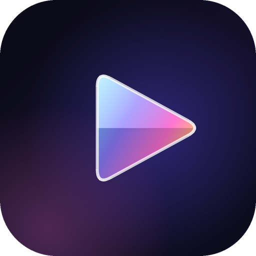

# Prism

Красивый видеоплеер для Android в стиле **Liquid Glass**, который играет практически всё (движок **libVLC**, как в VLC).
Автор: **RonovaDev** · GitHub: [RonovaMain](https://github.com/RonovaMain) · пакет `dev.ronova.prism`

## Возможности
- **Всеядность:** MKV, MP4, AVI, WMV, FLV, WebM, TS/M2TS, MOV, 3GP, OGV, RMVB, VOB и другое; аудиодорожки AC3/DTS/FLAC/Opus и т. д.; потоки HTTP/HLS/DASH/RTSP/RTMP/UDP/FTP/SMB.
- **«Открыть с помощью → Prism»** из любых файловых менеджеров, браузеров и мессенджеров (по MIME и по расширению файла).
- Дизайн «жидкое стекло» на библиотеке [Backdrop / AndroidLiquidGlass](https://github.com/Kyant0/AndroidLiquidGlass) (Apache 2.0): настоящее размытие и преломление фона, блик по кромке, кнопки, чипы, переключатели, ползунок перемотки и панель вкладок с «каплей», которую можно тянуть пальцем; анимированный фон, переливающийся логотип-призма.
  Линза (преломление) работает на Android 13+, размытие — на Android 12+; на более старых версиях стекло рисуется заливкой, бликом и тенью.
- Библиотека из медиатеки телефона: сетка или список, миниатюры, папки, поиск, сортировка, «Продолжить просмотр».
- Плеер: двойной тап слева/справа ±10 с, свайп по горизонтали — перемотка, свайп слева — яркость, справа — громкость, удержание — ускорение 2×, блокировка экрана, скорость 0.25–4×, формат кадра (вписать / обрезка / растянуть / 16:9 / 4:3 / оригинал), выбор аудиодорожек и субтитров, подключение внешних субтитров, сдвиг синхронизации, кодировка субтитров (Windows-1251 и др.), картинка в картинке, поворот экрана.
- Запоминает место просмотра, автопереход к следующему видео. Плейлист идёт в том порядке, в каком видео показано на экране.
- Вкладка «Сеть»: открыть ссылку, история ссылок. Настройки: тема (тёмная / светлая / системная), аппаратное декодирование, буфер сети и др.

## Сторонний код
Исходники библиотеки Backdrop (`app/src/main/java/com/kyant/backdrop`) и компонентов `LiquidButton`, `LiquidSlider`, `LiquidToggle`, `LiquidBottomTabs`
(`app/src/main/java/dev/ronova/prism/ui/liquid`) взяты из [Kyant0/AndroidLiquidGlass](https://github.com/Kyant0/AndroidLiquidGlass), лицензия Apache 2.0, и адаптированы под Prism.
